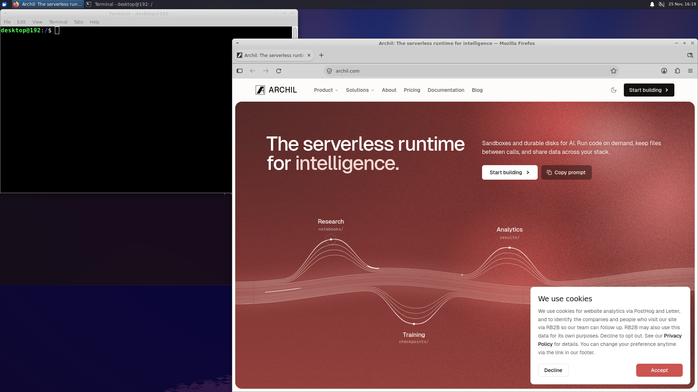

# Archil Sandbox Desktop

A Linux desktop you can open in your browser, running in an [Archil sandbox](https://docs.archil.com/compute/persistent-sandboxes).
It's Ubuntu 26.04 with Xubuntu's XFCE desktop and Firefox, served over VNC through noVNC. Use it yourself, share a
link with a teammate, or let a computer-use agent drive it while you watch.

This repository builds the image, `ghcr.io/archil-data/sandbox-desktop`. You run desktops with the
[`archil` CLI](https://www.npmjs.com/package/archil) or the [`disk` SDK](https://www.npmjs.com/package/disk).



## Quick start

```bash
npx archil login
npx archil sandbox create my-desk --desktop
npx archil sandbox desktop my-desk      # opens it in your browser, privately
npx archil sandbox ssh my-desk          # real SSH into the same machine
```

From code:

```ts
import { Archil } from "disk";
import { openDesktopTunnel } from "disk/tunnel";   // Node.js only

const client = new Archil();
const desk = await client.sandboxes.create({ name: "agent-desk", desktop: true });
await desk.desktop.start();

const png = await desk.desktop.screenshot();      // computer-use helpers
await desk.desktop.launch(["firefox", "https://example.com"]);
await desk.desktop.click(640, 400);
await desk.desktop.type("hello");
await desk.desktop.key("ctrl+l");

const viewer = await openDesktopTunnel(desk);     // private viewer on 127.0.0.1
console.log(viewer.viewerUrl);
```

See the [`disk` README](https://www.npmjs.com/package/disk) for sharing links, forks, and forwarding other ports.

## How it works

```
 your browser ──HTTPS/WSS──▶ Archil edge ──▶ sandbox :6080 websockify + noVNC ──▶ localhost:5901 Xtigervnc ◀── XFCE session
                (private: port token added      (checks the viewer token)            (not reachable from outside)
                 by a localhost tunnel;
                 shared: public hostname)
```

Inside the sandbox, `desktopctl up` registers three
[supervised services](https://docs.archil.com/compute/persistent-sandboxes#hosting-network-services):

| Service           | Runs                                                         |
| ----------------- | ------------------------------------------------------------ |
| `desktop-vnc`     | Xtigervnc on display `:1`, with VNC on `localhost:5901` only |
| `desktop-session` | XFCE as the unprivileged `desktop` user                      |
| `desktop-novnc`   | websockify on `:6080`. It serves the noVNC web client and only proxies to VNC when the request carries the viewer token. |

Service definitions persist on the sandbox's disk, so the desktop comes back by itself after a pause/resume or a
stop/start.

The viewer token is 256 bits from `/dev/urandom`. Without it, websockify closes the connection before any VNC
traffic flows. A private viewer reaches port 6080 through a localhost tunnel that authenticates with a short-lived
Archil port token, so the port is never public. A shared link exposes port 6080 on a public HTTPS hostname and
carries the viewer token. Anyone with that link can see and control the desktop until it's unshared, which replaces
the token and disconnects every viewer.

## Things to know

- **Timeouts.** Viewer traffic doesn't count as sandbox activity, so desktops are created with the idle timeout off
  and a 4-hour session cap instead. Private tunnels also hold a process connection, which keeps any sandbox awake
  while they run. A paused sandbox costs only storage. Delete desktops you're finished with.
- **Starting GUI apps.** A process started by `sandbox.exec` is killed when the exec returns. Use
  `desktop.launch(...)` (or `desktopctl launch <cmd>` inside the sandbox), which detaches the program.
- **SSH.** The image includes `openssh-server` and `rsync`, so `archil sandbox ssh` and `scp`/`rsync` to
  `<name>.archil` work right away. The image ships no SSH host keys; each sandbox creates its own on first use.
- **The `desktop` user** has passwordless `sudo`. The sandbox VM is the security boundary. Running the session as a
  non-root user lets the browser keep its own sandbox.
- **Firefox comes from Mozilla's APT repository** (signing key fingerprint checked at build time). Ubuntu's own
  `firefox` and `chromium` packages are snap wrappers, and snaps don't run in a sandbox. A policy file
  (`/etc/firefox/policies/policies.json`) skips the first-run screens and turns off telemetry.
- **No Super-key shortcuts.** Browsers send a Mac's Cmd key to the desktop as Super and often never send the key-up.
  If Super shortcuts existed, a stuck Cmd would turn plain typing into shortcuts (Super+E opens the file manager), so
  the install removes them.
- **Architectures.** Archil sandboxes may be x86_64 or arm64, so the image is built for both.
- **Base image.** The image is `ubuntu:26.04`. `install.sh` also works on `debian:trixie`, where you get plain XFCE
  instead of the Xubuntu look. Don't use `debian:trixie-slim`: it currently fails to boot as an Archil sandbox.

## Customizing

Build on the published image:

```dockerfile
FROM ghcr.io/archil-data/sandbox-desktop:latest
RUN apt-get update && apt-get install -y --no-install-recommends gimp libreoffice-writer
```

Then create desktops with `--base-image <your-ref>` (CLI) or `baseImage` (SDK) alongside `desktop: true`. Any public
OCI image works. For a private image, build it with `client.images.build({ source, registryAuth })` and pass
`imageId`.

Inside a running sandbox:

```
desktopctl up [--geometry WxH]   start the desktop (idempotent), print {"port","token"}
desktopctl token [--rotate]      print or replace the viewer token
desktopctl revoke                rotate the token and disconnect every viewer
desktopctl launch <cmd> [args]   start a GUI program on the desktop
desktopctl down                  stop the desktop and remove its services
desktopctl status                show the desktop services
```

## Development

`image/install.sh` is the single source of truth for what's on the desktop; the Dockerfile only runs it. Build the
image with:

```bash
docker buildx build --platform linux/amd64,linux/arm64 -t <ref> image/
```

To try a change without publishing an image, copy `image/` into a stock `ubuntu:26.04` sandbox, run
`sh install.sh` there, then `desktopctl up`.

CI builds every pull request and pushes `latest` (from `main`), version tags, and a tag per commit to
`ghcr.io/archil-data/sandbox-desktop`.

## License

MIT
